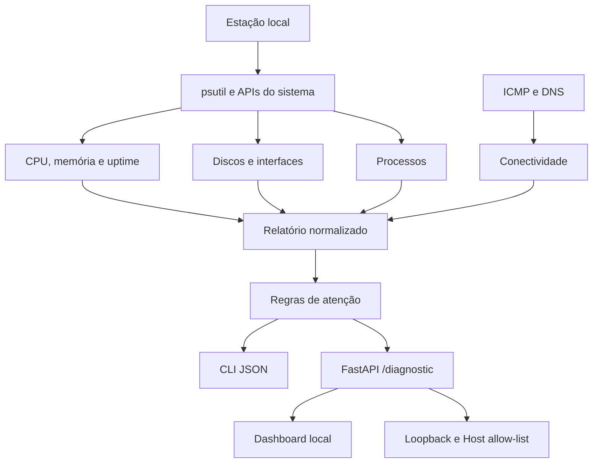

# Arquitetura

O toolkit separa coleta, interpretação e apresentação. O mesmo relatório é usado pela CLI e pelo dashboard, evitando duas implementações diferentes de diagnóstico.

## Módulos

- `support_toolkit.py`: funções de coleta, formatação do relatório e CLI.
- `web_app.py`: camada HTTP. Devolve mensagem genérica ao navegador quando a coleta falha, registra detalhes localmente e restringe acesso à origem local.
- `frontend.html`: apresentação dos dados devolvidos pela API.

## Coleta e limites

A utilização de CPU é amostrada durante a execução. O uso de processos exige duas leituras separadas por um pequeno intervalo; processos encerrados durante essa janela são ignorados. Volumes sem permissão de leitura são omitidos.

O teste ICMP consulta um endereço externo uma única vez. Firewalls podem bloquear esse tipo de pacote. A resolução DNS usa o resolvedor configurado no sistema. Nenhum dos dois resultados, isoladamente, determina a causa de uma falha de rede.

## Segurança

O dashboard não possui autenticação. O servidor aceita somente clientes com IP de loopback e cabeçalhos Host locais. Execute em `127.0.0.1` e não o exponha diretamente nem através de proxy reverso. Os relatórios podem conter endereços, hostname, processos e pontos de montagem.
