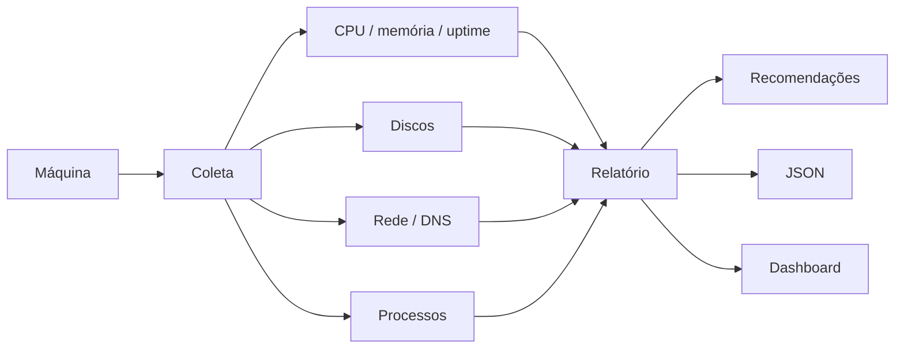

# Arquitetura

A proposta do toolkit é coletar informação antes de sair alterando configuração da máquina.

A coleta é somente leitura. O projeto não altera registro, firewall, usuários ou políticas do Windows.

A ideia é usar o relatório como ponto de partida para troubleshooting, em vez de executar correções automáticas sem saber primeiro o que está acontecendo.
