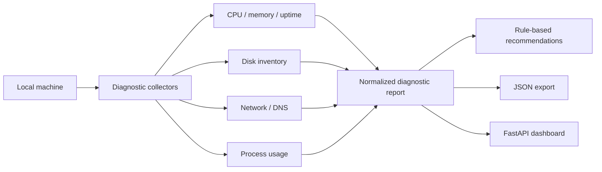

# Architecture

## Goal

IT Support Toolkit collects diagnostic evidence before corrective action. The project is intentionally read-only.

## Flow

## Design principle

Evidence comes before remediation. The toolkit does not modify registry settings, firewall rules, local users, policies or system configuration.

## Production evolution

Future versions can add signed reports, remote collection through an authenticated agent, structured incident bundles, inventory correlation and integrations with monitoring or ITSM systems.
